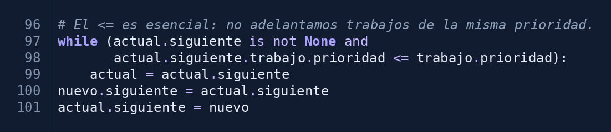
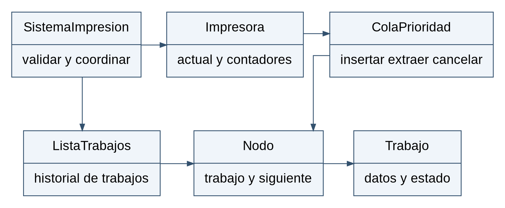
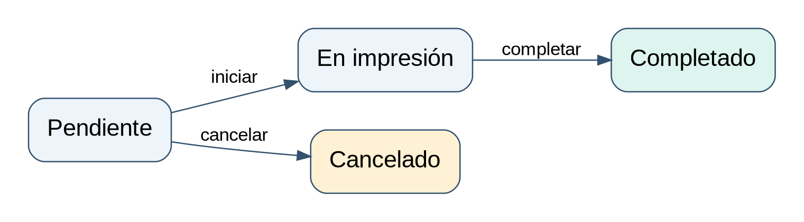
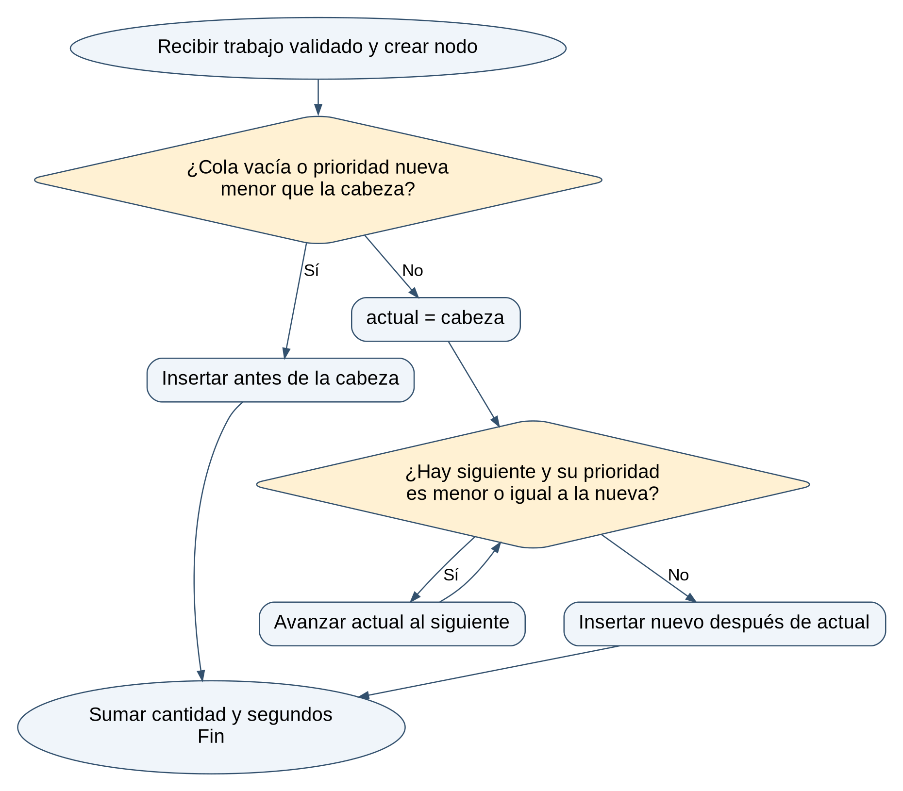
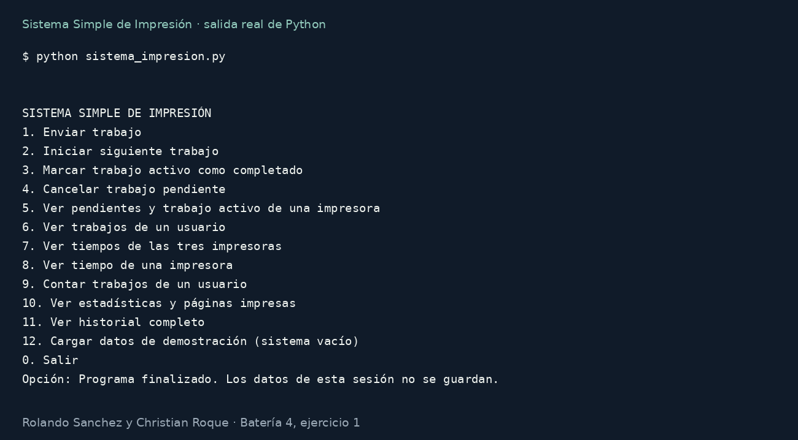
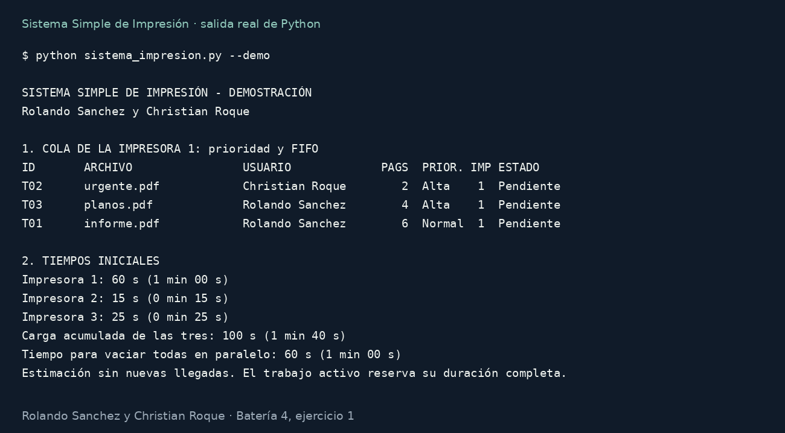
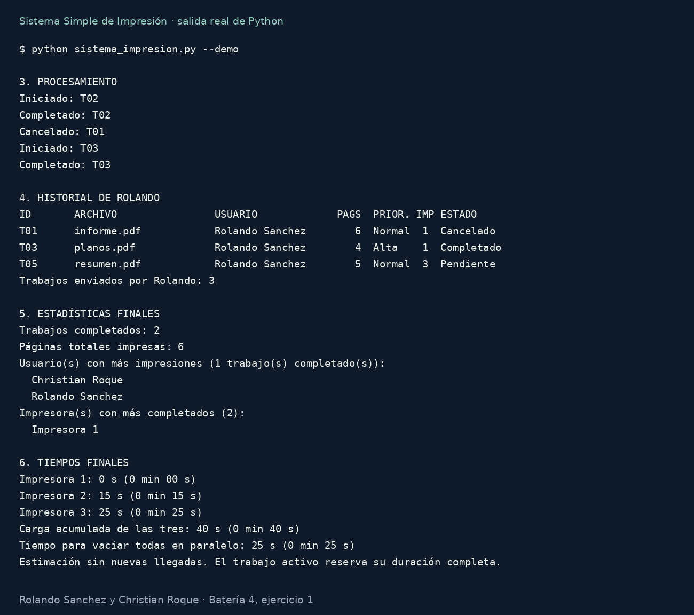
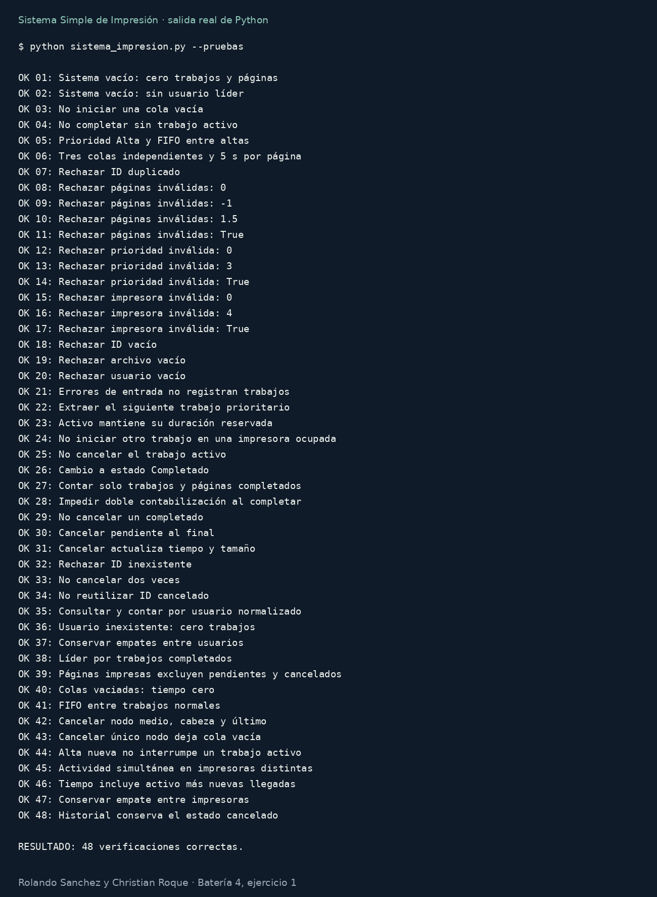

# Sistema Simple de Impresión

**Trabajo final · Batería 4 · Ejercicio 1**  
**Integrantes:** Rolando Sanchez y Christian Roque

**Documentación:** [Informe técnico en Word](docs/informe/Informe_Sistema_Impresion_Sanchez_Roque.docx). El informe desarrolla el problema, el diseño, los algoritmos y las evidencias. Este README reúne la documentación solicitada para el repositorio.

## Archivos para la exposición

[Diseño editable en Canva](https://www.canva.com/d/5f1H1_tQs_jI-Rh). Las copias PowerPoint y PDF incluidas reproducen el rediseño aprobado.

- [Diapositivas en PowerPoint](docs/presentacion/Diapositivas_Sistema_Impresion.pptx).
- [Diapositivas en PDF](docs/presentacion/Diapositivas_Sistema_Impresion.pdf).
- [Guion de Rolando Sanchez y Christian Roque](docs/exposicion/GUION_EXPOSICION.md).

## Organización del proyecto y entrega

La guía exige un **archivo `.py` único y ejecutable** con todas las clases, el menú y un bloque de pruebas al final. Por eso `sistema_impresion.py` sigue siendo el archivo oficial para Canvas. Contiene las seis clases implementadas desde cero.

Para desarrollar y revisar el proyecto en GitHub, las mismas responsabilidades también están separadas en módulos:

| Archivo | Responsabilidad |
| --- | --- |
| `main.py` | Ejecuta el menú, la demostración o las pruebas de la versión modular. |
| `impresion/trabajo.py` | Clase `Trabajo`: datos, estado y duración del documento. |
| `impresion/nodo.py` | Clase `Nodo`: referencia al trabajo y enlace siguiente. |
| `impresion/lista_trabajos.py` | Clase `ListaTrabajos`: historial enlazado. |
| `impresion/cola_prioridad.py` | Clase `ColaPrioridad`: insertar, extraer y cancelar pendientes. |
| `impresion/impresora.py` | Clase `Impresora`: cola, trabajo activo y contadores. |
| `impresion/sistema.py` | Clase `SistemaImpresion`: validaciones y coordinación de las tres impresoras. |
| `impresion/consola.py` | Lectura de datos, consultas, menú y demostración. |
| `impresion/pruebas_funcionales.py` | Las 48 verificaciones de funcionamiento. |
| `herramientas/generar_entrega.py` | Genera el archivo único a partir de los módulos. |
| `.github/workflows/verificar.yml` | Verifica ambas versiones y su demostración en GitHub Actions. |

### Ejecutar la versión modular

Desde la raíz del proyecto:

```bash
python main.py
python main.py --demo
python main.py --pruebas
```

No requiere dependencias externas. Los imports entre módulos solo conectan nuestras propias clases; las estructuras de datos continúan implementadas desde cero.

### Regenerar el archivo para Canvas

Después de modificar la lógica, editar los módulos y ejecutar:

```bash
python herramientas/generar_entrega.py
python sistema_impresion.py --pruebas
python main.py --pruebas
```

El generador reúne los bloques en orden, mantiene todas las clases dentro del archivo oficial y coloca el bloque de pruebas al final. No editar directamente `sistema_impresion.py`: la siguiente generación sobrescribe ese archivo. Conservar el marcador de cada módulo.

En esta reorganización, el archivo oficial conserva exactamente el código anterior. Las capturas, los números de línea, el informe, las diapositivas y sus resultados siguen correspondiendo al archivo entregado.

Para Canvas se presentan `sistema_impresion.py`, este README y el enlace del repositorio. El repositorio incluye además los módulos y los recursos utilizados por el README. La guía solicita compartirlo con `lmelendez-tecsup`.

## 1. Introducción al problema

Un centro de cómputo comparte tres impresoras entre varios usuarios. Atender únicamente por orden de llegada retrasa los documentos urgentes. Este proyecto organiza cada impresora con una cola de prioridad propia y conserva un historial de todos los trabajos enviados.

El sistema permite enviar, iniciar, completar y cancelar trabajos. También consulta los trabajos por impresora y usuario, calcula tiempos estimados y presenta estadísticas de impresión.

## 2. Ejecución

Requisito: **Python 3.10 o superior**. No requiere instalar paquetes ni conectar una impresora física.

Desde la carpeta del proyecto:

```bash
python sistema_impresion.py
```

En Windows, si `python` no está disponible, use `py` en los mismos comandos.

```bash
python sistema_impresion.py --demo
python sistema_impresion.py --pruebas
```

- Sin argumentos: abre el menú interactivo.
- `--demo`: ejecuta una demostración reproducible sin solicitar datos.
- `--pruebas`: ejecuta las 48 verificaciones del bloque de pruebas al final del archivo.

El código fuente completo está en **un único archivo ejecutable**, `sistema_impresion.py`. Solo importa `sys`, de la biblioteca estándar, para reconocer los argumentos de ejecución. No utiliza `heapq`, `queue`, `collections`, estructuras de terceros ni servicios externos.

## 3. Estructura de datos elegida

Se implementó una **cola de prioridad mediante una lista simplemente enlazada y ordenada**, desde cero. Cada impresora contiene una instancia independiente de `ColaPrioridad`.

Cada nodo almacena una referencia a un trabajo y al siguiente nodo. La cabeza contiene siempre el siguiente trabajo que debe atenderse. Al insertar, se recorre la cola hasta encontrar el lugar que conserva estas reglas:

1. Prioridad **Alta = 1** antes que **Normal = 2**.
2. Entre trabajos de igual prioridad se conserva **FIFO**, primero en entrar, primero en salir.
3. La prioridad se aplica a los pendientes de la impresora elegida. Un trabajo nuevo no interrumpe otro que ya está en impresión.

La condición `<=` coloca cada trabajo nuevo después de los anteriores de su misma prioridad:

```python
while (actual.siguiente is not None and
       actual.siguiente.trabajo.prioridad <= trabajo.prioridad):
    actual = actual.siguiente
nuevo.siguiente = actual.siguiente
actual.siguiente = nuevo
```

Extraer el siguiente solo requiere mover la cabeza:

```python
trabajo = self.primero.trabajo
self.primero = self.primero.siguiente
self.cantidad -= 1
self.segundos_pendientes -= trabajo.segundos
return trabajo
```

Se eligió esta implementación por la facilidad para explicar la prioridad, FIFO y la cancelación por ID. Una cola FIFO simple no adelanta urgentes. Un heap también es válido, pero requiere un criterio adicional de desempate para conservar FIFO. La lista ordenada simplifica ese requisito a cambio de una inserción lineal.

Además, `ListaTrabajos` implementa un historial enlazado propio. El historial y la cola usan nodos distintos que referencian el mismo objeto `Trabajo`. Por ello, completar o cancelar actualiza el estado visible en todas las consultas. La tupla fija de tres impresoras solo agrupa objetos y no reemplaza la implementación propia de las colas.

### Fragmento del archivo fuente



Las imágenes de código se obtuvieron del archivo `sistema_impresion.py` incluido, con sus números de línea. Son fragmentos del código ejecutado y no pseudocódigo.

## 4. Diseño de clases

| Clase | Responsabilidad |
| --- | --- |
| `Trabajo` | Guarda ID, archivo, usuario, páginas, prioridad, impresora y estado. Calcula páginas × 5 segundos. |
| `Nodo` | Enlaza un trabajo con el siguiente nodo. |
| `ListaTrabajos` | Conserva el historial y permite agregar, buscar por ID y recorrer. |
| `ColaPrioridad` | Inserta según prioridad y FIFO, extrae la cabeza, cancela por ID y acumula el tiempo pendiente. |
| `Impresora` | Administra una cola, un trabajo activo y contadores de trabajos y páginas completados. |
| `SistemaImpresion` | Coordina las tres impresoras, valida datos y proporciona consultas y estadísticas. |

Los estados posibles son `Pendiente`, `En impresión`, `Completado` y `Cancelado`. Se permite pasar de Pendiente a En impresión o Cancelado. Un trabajo En impresión solo pasa a Completado. Los estados finales permanecen en el historial.





### Flujo de inserción



El caso de inserción al inicio compara con menor estricto. El recorrido del resto de la cola usa menor o igual para preservar FIFO. En ambos caminos se actualizan la cantidad y los segundos pendientes.

## 5. Operaciones implementadas

| Opción | Operación | Comportamiento |
| --- | --- | --- |
| 1 | Enviar trabajo | Solicita ID, archivo, usuario, páginas, prioridad e impresora. Valida y encola. |
| 2 | Iniciar siguiente | Extrae el trabajo prioritario y lo marca En impresión. La impresora debe estar libre. |
| 3 | Completar | Finaliza el trabajo activo e incrementa trabajos completados y páginas impresas una sola vez. |
| 4 | Cancelar | Retira un trabajo pendiente por ID. Conserva su registro con estado Cancelado. |
| 5 | Consultar impresora | Muestra el trabajo activo y los pendientes en orden real de atención. |
| 6 | Consultar usuario | Muestra su historial, incluidos todos los estados. |
| 7 | Tiempos generales | Muestra carga por impresora, carga acumulada y tiempo para vaciar las tres en paralelo. |
| 8 | Tiempo individual | Calcula la carga de la impresora seleccionada. |
| 9 | Contar por usuario | Cuenta todos los trabajos enviados, incluidos cancelados y completados. |
| 10 | Estadísticas | Total completado, páginas impresas, usuario con más impresiones e impresora con más completados. |
| 11 | Historial completo | Permite revisar todos los trabajos registrados. |
| 12 | Cargar demostración | Registra cinco trabajos, solo si el sistema está vacío. |
| 0 | Salir | Finaliza la sesión. |

**Criterios de consulta:** los nombres de usuario se comparan sin distinguir mayúsculas y se eliminan espacios en los extremos. Los IDs distinguen mayúsculas y no pueden reutilizarse aunque el trabajo termine o se cancele. “Usuario con más impresiones” significa mayor cantidad de **trabajos completados**, no mayor cantidad de páginas. Todos los empates se muestran. Si todavía no hay completados, se indica que no existe un líder.

## 6. Cálculo de tiempos

Cada página tarda **5 segundos**:

```text
Duración de un trabajo = páginas × 5
Carga de una impresora = tiempo pendiente + duración del trabajo activo
Carga acumulada = carga 1 + carga 2 + carga 3
Tiempo para vaciar las tres en paralelo = máximo(carga 1, carga 2, carga 3)
```

Ejemplo: las cargas 60, 15 y 25 segundos suman **100 segundos de trabajo**, pero requieren **60 segundos** si las impresoras operan simultáneamente, sin nuevas llegadas y sin pausas entre trabajos.

El programa es una **simulación manual**: iniciar y completar son acciones del usuario. No imprime archivos reales ni descuenta tiempo de reloj. Mientras un trabajo está activo, se reserva su duración completa. Las estimaciones representan carga de servicio para terminar lo registrado, no el tiempo exacto transcurrido ni la espera individual antes de iniciar cada documento. Las llegadas de nuevos urgentes pueden cambiar el orden pendiente.

## 7. Análisis de complejidad

Sea **N** el total de trabajos conservados en el historial y **n** la cantidad pendiente en la impresora consultada. Hay exactamente tres impresoras. Las comparaciones de textos se consideran de longitud acotada. Se presenta el peor caso.

| Operación | Tiempo | Justificación |
| --- | --- | --- |
| `ColaPrioridad.insertar` | O(n) | Recorre los nodos para conservar prioridad y FIFO. |
| `ColaPrioridad.extraer` | O(1) | Retira la cabeza. |
| `ColaPrioridad.cancelar` | O(n) | Busca y desenlaza el nodo por ID. |
| `ListaTrabajos.agregar` | O(1) | Usa el puntero al último nodo. |
| Buscar ID en historial | O(N) | Recorre el registro enlazado. |
| `SistemaImpresion.enviar` | O(N + n), equivalente a O(N) | Busca ID duplicado y luego inserta en la cola. |
| `SistemaImpresion.iniciar` | O(1) | Selección directa de impresora y extracción de cabeza. |
| `SistemaImpresion.completar` | O(1) | Cambia estado y actualiza contadores. |
| `SistemaImpresion.cancelar` | O(N + n), equivalente a O(N) | Busca en el historial y luego en la cola. |
| Listar pendientes | O(n) | Muestra todos los pendientes. |
| Listar o contar trabajos de usuario | O(N) | Filtra el historial una vez. |
| Tiempo de una o de todas las impresoras | O(1) | Usa tiempos acumulados y recorre solo tres impresoras. |
| Totales de completados y páginas | O(1) | Suma tres contadores. |
| Usuario con más impresiones / reporte completo | O(N²) | Recorre el historial por usuario candidato sin usar un diccionario auxiliar. |
| Impresora con más completados | O(1) | Compara tres contadores. |

El espacio total es **O(N)**: se conservan los trabajos del historial y como máximo un nodo adicional de cola por trabajo pendiente. El reporte de líderes usa una lista enlazada auxiliar de tamaño O(U), donde U es la cantidad de usuarios empatados, con U ≤ N.

**Posible mejora:** para un volumen grande, un índice propio por usuario e ID reduciría búsquedas y el costo del reporte. Se mantuvo la solución enlazada para hacer visibles las operaciones de la estructura solicitada.

## 8. Demostración y resultados esperados

La opción 12 y `--demo` cargan estos mismos datos:

| ID | Archivo | Usuario | Páginas | Prioridad | Impresora |
| --- | --- | --- | --- | --- | --- |
| T01 | informe.pdf | Rolando Sanchez | 6 | Normal | 1 |
| T02 | urgente.pdf | Christian Roque | 2 | Alta | 1 |
| T03 | planos.pdf | Rolando Sanchez | 4 | Alta | 1 |
| T04 | ficha.pdf | Christian Roque | 3 | Normal | 2 |
| T05 | resumen.pdf | Rolando Sanchez | 5 | Normal | 3 |

En la impresora 1, el orden es **T02, T03, T01**. T02 y T03 adelantan a T01 por tener prioridad Alta. T02 permanece antes de T03 por FIFO.

Secuencia recomendada para la exposición:

1. Iniciar el programa y cargar los datos con la opción 12.
2. Opción 5, impresora 1: comprobar el orden T02, T03, T01.
3. Opción 7: comprobar cargas de 60, 15 y 25 segundos.
4. Opción 2, impresora 1: iniciar T02.
5. Opción 3, impresora 1: completar T02.
6. Opción 4: cancelar T01.
7. Opciones 2 y 3, impresora 1: iniciar y completar T03.
8. Opción 6: consultar a Rolando Sanchez. Deben aparecer T01 cancelado, T03 completado y T05 pendiente.
9. Opción 10: comprobar **2 trabajos completados y 6 páginas impresas**. Los dos usuarios empatan con un trabajo completado. La impresora 1 lidera con dos completados.
10. Opción 7: comprobar cargas finales 0, 15 y 25 segundos. Carga acumulada 40 segundos y finalización paralela 25 segundos.

## 9. Capturas de ejecución

Las imágenes presentan la salida real obtenida al ejecutar el archivo entregado, en una vista de consola para facilitar la lectura. No representan conexión con hardware ni impresión física.

### Menú interactivo



### Orden de prioridad y tiempos iniciales



### Procesamiento, historial y estadísticas



### Bloque de pruebas



Las pruebas cubren orden por prioridad, FIFO entre altas y entre normales, colas independientes, cancelación en cabeza/medio/final, cola vacía, validación de campos y tipos, IDs duplicados, actividad simultánea, trabajo activo sin interrupción, empates y contadores. El resultado esperado es `RESULTADO: 48 verificaciones correctas.`

La salida íntegra de demostración y pruebas está en [evidencia_ejecucion.txt](evidencia_ejecucion.txt). Las imágenes de salida presentan ese texto capturado del programa en una vista de consola.

## 10. Alcance y limitaciones

- El usuario elige una de las tres impresoras al enviar cada trabajo.
- Los datos permanecen en memoria durante la sesión. Reiniciar crea un sistema vacío.
- El nombre del archivo se registra como texto. No se abre ni se exige que exista físicamente.
- La simulación no administra drivers, hilos, red ni tiempo real.
- La prioridad estricta puede retrasar trabajos normales si ingresan urgentes continuamente.

## 11. Conclusiones del equipo

1. La cola de prioridad permite atender primero los documentos urgentes y mantiene el orden de llegada entre trabajos de igual prioridad.
2. Separar las tres colas facilita consultar la carga de cada impresora y conservar un control independiente de sus trabajos.
3. El historial y las validaciones evitan duplicar IDs y contar como impresas páginas de trabajos cancelados o pendientes.
4. Las pruebas permitieron comprobar las reglas principales y los casos de error antes de presentar el programa.

## 12. Preparación de la entrega

Según las indicaciones, en la semana 15 se entregan el archivo Python, el README y el enlace del repositorio en Canvas. En GitHub se publican los archivos del proyecto y se comparte el repositorio con **`lmelendez-tecsup`**. Subir también la carpeta `capturas` es necesario para que las imágenes del README se visualicen correctamente.

La presentación de la semana 16 debe tener entre 10 y 15 diapositivas y durar 8 minutos. La fecha exacta se consulta en Canvas. El enlace del repositorio se incorpora después de crear o seleccionar el repositorio y publicarlo en la cuenta del equipo.

La presentación preparada tiene **15 diapositivas** e incluye notas para los expositores: [Abrir presentación en Canva](https://www.canva.com/d/5f1H1_tQs_jI-Rh). El reparto de los 8 minutos y los puntos para explicar están en `docs/exposicion/GUION_EXPOSICION.md`.

Los diagramas incluyen sus archivos fuente `.dot` en `diagramas`. Las imágenes del README se conservan en `capturas`, `imagenes_codigo` y `diagramas`; deben subirse junto al archivo Markdown.
